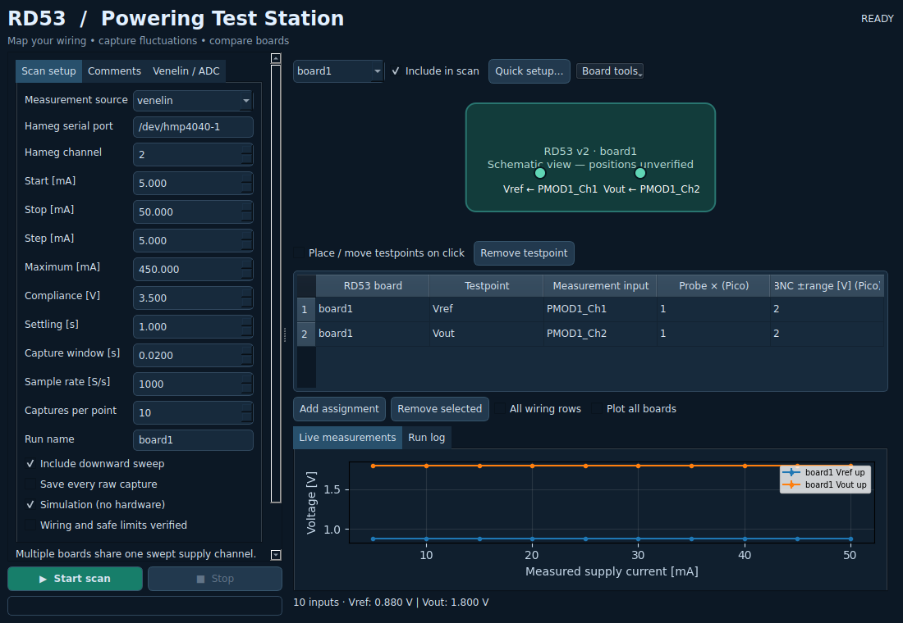

# RD53 v2 shunt-board current scan

Scan the current supplied to a shunt-regulator testboard and measure its
reference and output voltage. Reuses the HMP4040 and PicoScope 6426E / PS6000A
instrument code from the charge-pump measurement project
(`chargepump_measurement_hmp_settle_guard_20260731.zip`).
Hardware operation has not yet been verified on these RD53 boards.

## Connections

| Instrument | Channel | Connection |
| --- | --- | --- |
| Hameg / R&S HMP4040 | CH2 | Testboard power input and return |
| PicoScope 6426E | CH1 / A | Reference voltage relative to board return |
| PicoScope 6426E | CH2 / B | Output voltage relative to board return |

Use the board's documented input terminals; its pinout is not assumed here.
Both scope channels use DC coupling, high impedance and a configurable probe
attenuation (default x1). Both probe grounds go to the same board return.
This setup is for a single board at a common scope ground; ordinary grounded
probes must not be attached to different floating returns in a serial chain.
Close PicoScope's desktop application before opening the SDK connection.

## Install

Python 3.10+:

```bash
python3 -m venv .venv
source .venv/bin/activate
python -m pip install -r requirements.txt
```

Hardware runs additionally require Pico Technology's native **PS6000A** SDK
library (`libps6000a` on Linux), installed from the vendor, and USB/serial access
permissions. `pip install picosdk` installs the Python wrapper, not the native
library. This driver targets the earlier **6426E**; other PicoScope families
require a different driver/API. Windows can use `--port COM3` (choose the actual
port) and `.venv\Scripts\activate`.

## First try: simulated scan

```bash
python scan.py --simulate --start 0.005 --stop 0.050 --step 0.005 \
  --voltage-limit 1.5 --max-current 0.050 --name demo --reverse
```

These numbers are **simulation examples, not validated RD53 board ratings**.
The program never energizes hardware in simulation mode.

## Hardware scan

Set values from the testboard documentation / your established safe operating
limits, then run (all current arguments are in amperes):

```bash
python scan.py --port /dev/ttyUSB1 --channel 2 \
  --start START_A --stop STOP_A --step STEP_A \
  --voltage-limit SAFE_COMPLIANCE_V --max-current SAFE_MAX_A \
  --settle 1 --captures 10 --name board_01
```

Replace the uppercase placeholders with numeric values. The compliance voltage
is the Hameg voltage setpoint: enough headroom for the regulator but within the
board's safe limit. Setting `CURR` controls the current limit. The supply delivers
the requested current only if the load can draw it within the compliance voltage.
Consequently the CSV records actual current before and after the captures;
plots use their average. `CURRENT NOT REACHED` flags deviation greater than
max(0.1 mA, 2% of the current setting); it is a tracking diagnostic, not a
calibrated CC/CV status or a board pass/fail criterion.

Start and stop must be positive. Steps are uniform; the stop is included only
when it lies on the step grid. `--reverse` repeats the highest point and then
scans down, useful for checking hysteresis. Add `--save-waveforms` for every raw
capture; use `--reference-probe 10 --output-probe 10` for x10 probes. Input ranges
are BNC full-scale ±voltages, before multiplying by probe attenuation.
Supported ranges: 0.01, 0.02, 0.05, 0.1, 0.2, 0.5, 1, 2, 5, 10, 20 V.

The scope connects before power is enabled. The HMP adapter verifies setpoints,
uses staged delays, avoids the old driver's global reset, and disables the
selected output on completion, acquisition failure or Ctrl+C. It does not change
other channels' setpoints/selections. When the master is initially off, it refuses
to enable it if another channel is selected, since that would energize that
channel too. Leave supply front-panel controls untouched during a run.
Output-disable failures are reported as errors: manually verify power is off.
Termination by SIGKILL, loss of PC power or loss of communication cannot guarantee
shutdown, so the programmed hardware current and voltage limits remain essential.

## Saved results

Each run creates `results/<name>/<UTC timestamp>/`:

- `results.csv`: requested/measured current, supply voltage, reference/output
  mean, spread of repeated capture means, waveform RMS noise and peak-to-peak.
- `voltages.png` and `voltages.pdf`: two panels, reference/output versus actual
  supply current, with separate up/down curves.
- `metadata.json`: settings, actual scope resolution, supply identity,
  completion status and shutdown errors. Simulation is explicitly recorded.
- Optional `waveforms_*.npz`: voltage arrays and sample interval in seconds.

Error bars are the sample standard deviation of repeated **capture means**;
they are not the total measurement uncertainty. Waveform RMS noise is reported
separately, and neither quantity includes calibration/probe systematic errors.
The driver rejects scope over-range instead of saving clipped voltage readings.
CSV is flushed after each point, and partial results/plots survive ordinary
exceptions or Ctrl+C. The script does not determine regulator pass/fail thresholds.

## Tests

```bash
python -m unittest discover -s tests -v
```

Tests cover the sweep grid, limits, reverse scan and shutdown on errors/Ctrl+C.
A simulation exercises CSV and plot generation without Pico SDK or hardware.

## References

- [R&S HMP Series manual](https://scdn.rohde-schwarz.com/ur/pws/dl_downloads/pdm/cl_manuals/user_manual/1178_6833_01/HMPSeries_UserManual_en_04.pdf)
- [PicoScope PS6000A programmer's guide](https://www.picotech.com/download/manuals/picoscope-6000-series-a-api-programmers-guide.pdf)
# rd53-current-scan
# rd53-current-scan


## Desktop test station and Venelin ADC support

Update and launch:

```bash
git pull
python -m pip install -r requirements-gui.txt
python gui.py
```

The GUI starts in **simulation** mode. Set the Hameg device (default now
`/dev/hmp4040-1`), choose Pico or Venelin, and assign physical measurement inputs
to board/testpoint pairs. Start/stop controls, live plots, voltage readouts and
progress are included. Current fields in the GUI are **mA**; command-line current
arguments remain **A**. Configure Pico probe factors explicitly to match x1/x10
switches. Input assignments document your physical wiring; software does not
move probes or operate a hardware multiplexer.

- Add independent RD53 board IDs and testpoint names.
- Click a testpoint to select its assignment row; the row fields are editable.
- Load a board photo, enable “Place / move testpoints on click”, and click to add
  a named marker or move an existing one. Coordinates are saved with the profile.
- Save/load JSON wiring profiles, including probe factors, ranges and ADC paths.
  Photo paths are absolute local paths; copy photos separately when moving machines.
- Start a simulated run first. Hardware runs require checking the wiring/limits
  checkbox. Stop requests cooperative shutdown without force-killing the worker;
  closing the window while running requests Stop and defers closure until stopped.
  A single Pico block can take until its acquisition timeout to return.

The default graphic is a **schematic**, not a verified drawing of your PCB.
Vref/Vout are measurement labels, not inferred connector or TP numbers. Supply
safe ratings and physical testpoint positions from your actual board documentation.

### Venelin setup

Use the updated `SimonGB/pmod_adc` checkout and build its C++ helpers first.
The scan uses `install/bin/pm_adcs_quick_ini` for normal initialization at the
selected sample rate and `pm_adcs_startl` for fresh finite records. Set its serial
port at build time as described in that project's README. Close its GUI and
other acquisition processes before running this station; helper initialization
stops an existing board stream.

In the Venelin GUI tab choose that repository's root, `exe/pgm/config.toml`,
and the decoded data path (normally `exe/pgm/fadc.dat`). The helper's compiled
output path must match the selected data path. Select a sample rate of 250,
500, 1000, 2000, 4000, 8000, 16000 or 32000 S/s. The new adapter controls only
one ADC motherboard and its PMOD1..6 modules.

Channel IDs are physical `PMODn_Ch0..7` identities. The adapter derives sparse
acquisition masks, then matches decoded file-header identities to channels;
it never assumes that CSV column number is the global channel number. Input
profiles come from the TOML `[BoardInputs]` and `[Calibration]` sections:

- `dV`: signed ADC code × connector full-scale voltage / 2^(bits−1).
- `I`: convert shunt voltage, then divide by configured measurement shunt ohms.
- `aV`: use its configured absolute-voltage full-scale span.

Fitted types/gains must agree with the hardware. Software cannot turn an I input
into a dV input. The adapter applies nominal configured scaling; it **does not
import the PMOD GUI's separate two-point calibration records**. It does not run
zero calibration. ADC full-scale clipping, missing inputs, malformed/short
captures, acquisition timeouts and unchanged output files cause an error and
supply shutdown. A frame's physical inputs are sampled together; consecutive
captures and Pico versus ADC runs are not synchronized with each other.

Example using a wiring profile (replace its ADC paths first):

```bash
python scan.py --profile profiles/venelin-example.json \
  --port /dev/hmp4040-1 --start 0.005 --stop 0.050 --step 0.005 \
  --voltage-limit 3.5 --max-current 0.450 \
  --sample-rate 1000 --capture-time 0.1 --captures 10 \
  --name board1_adc --reverse --save-waveforms
```

These current/voltage values reflect the earlier bench command and are not
universal RD53 ratings. `profiles/pico-example.json` preserves A/B wiring with
x1 factors; adjust them if your probes are x10. Add `--simulate` to test either
profile without hardware. Original scans without `--profile` remain supported.

### Multiple RD53 boards

Multiple board IDs may be monitored during one shared Hameg-channel current
sweep. The Pico adapter currently supports **two total mapped inputs**; these
can be on different boards only when their measurement returns permit it. The
Venelin adapter can select up to **48 inputs** across six PMOD modules, subject
to installed modules and their fitted input types. This update does not control
multiple independent supplies or sequence separate boards with relays.

For a serial chain, verify differential-input common mode, amplifier supply
rails and total chain voltage against the actual ADC board documentation. The
board quickstart gives a nominal differential common-mode range of 0..27 V;
ordinary Pico probes share ground, and ADC inputs are not isolated. Physical
wiring must not short floating board returns together.

### Mapped output and fluctuations

Mapped runs create `measurements.csv` in **long format**, one row per board /
testpoint / current point, plus `mapped_voltages.png/.pdf` and metadata containing
the complete wiring profile, input scaling and run status.

- `capture_std`: standard deviation between repeated record means (plot bars).
  Empty when only one capture exists, since that statistic cannot be estimated.
- `sample_std`: sample standard deviation across all recorded samples, including
  between-record shifts.
- `within_capture_rms`: RMS fluctuations around each record's own mean.
- `peak_to_peak`: maximum minus minimum across all captures at that point.

V channels use V and I channels use A for these statistics. None of these is a
calibrated total measurement uncertainty. Samples can be correlated; increasing
sample count alone does not eliminate systematic errors. Raw `.npz` files store
scaled signals and nominal sample interval; acquisition gaps between records
are not part of that interval.

### Useful next additions

Prioritize a measured gain/offset calibration with provenance; voltage/temperature
abort thresholds; repeat-scan overlays and board comparison; automatic settling
detection; long-duration drift monitoring; and load-step measurements. Later,
add topology profiles for parallel/series/mixed configurations, independent supply
channels and hardware switching only after the corresponding wiring and hardware
interfaces are defined.

### Linux GUI startup: GNOME antialiasing schema error

If startup aborts with `org.gnome.settings-daemon.plugins.xsettings` missing
`antialiasing`, the desktop GTK/GNOME theme integration is incompatible with
its loaded settings schema. On Linux this GUI now selects Qt generic theming
and Fusion style before constructing QApplication. These settings apply only
to this process; the system desktop configuration is unchanged.

Update with `git pull` and launch `python gui.py`. For an older checkout, try:

```bash
QT_QPA_PLATFORMTHEME=generic QT_STYLE_OVERRIDE=Fusion python gui.py
```

To explicitly opt back into native desktop themes, use
`RD53_NATIVE_QT_THEME=1 python gui.py`. This bypass has been startup-tested
in an offscreen environment; the reported desktop crash cannot be reproduced
without the bench computer\x27s library/schema combination.

### Run comments

Use the GUI's **Comments** tab before starting a scan. Notes are stored in
`comments.txt`, run metadata and the `comments` column of every CSV row.
Multiline text is preserved with CSV quoting. The field remains editable during a run. Each update is saved with a UTC timestamp and revision; completed CSV rows retain their original point-specific note snapshot. Notes remain
in the GUI for the next run; edit or clear them as needed.

The CLI also supports `--comments "Board 1; probes x10; room temperature 23 C"`
with or without a wiring profile.

### Input types shared with the PMOD GUI

The RD53 adapter now loads `gui_board_inputs.json` beside the selected
`config.toml`, when present. This is the input setup saved by the PMOD GUI;
it takes precedence over TOML input profiles. Invalid saved setups abort
instead of silently reverting. Without a saved setup, explicit TOML profiles
still override the confirmed RD53-rig defaults:

| Modules | Current inputs | Differential voltage inputs | Absolute voltage inputs |
| --- | --- | --- | --- |
| PMOD1/2 | Ch0 | Ch1..Ch5 | Ch6/7 |
| PMOD3..6 | Ch0, Ch3 | Ch1, Ch2, Ch4, Ch5 | Ch6/7 |

Use **Venelin / ADC → Show effective ADC types / units** to inspect the selected
inputs, their engineering-unit full scale and the active settings source before
running. If an existing saved setup or explicit TOML profile still identifies
PMOD1 Ch3 as I, correct it in the PMOD GUI's input editor and save, then restart
the RD53 acquisition. Do not simply relabel old data: an incorrect type changes
the numeric conversion as well as the unit.

At nominal scales, a raw half-scale code on a dV input means 1.8 V; treating it
as an I input with 12 mV full scale and a 5 mOhm measurement shunt instead yields
1.2 A. Both the type and the full-scale/shunt settings must match fitted hardware.
The RD53 live plot now separates V and A signals onto distinct labelled axes;
CSV remains in V/A, while the swept Hameg current axis is displayed in mA.
The example Venelin wiring now uses Ch1/Ch2, leaving the fitted Ch0 current input
unassigned. Existing user wiring profiles retain their explicit assignments.

### Multi-PMOD initialization and timeout diagnostics

The RD53 station now derives the ADC chip mask from the mapped inputs and
passes it to `pm_adcs_quick_ini` together with an active DRDY chip and transfer
width. Channel readout masks and initialized ADCs therefore describe the same
modules. PMOD1 + PMOD2 uses chip mask `0x3`; PMOD2 alone uses `0x2` and DRDY
chip index 1. Only actually installed/connected PMOD modules should be assigned.

Update and rebuild the PMOD helpers once:

```bash
cd ~/pmod_adc
git pull
bash scripts/build.sh
```

Then update this repository and relaunch the GUI. Local tracked configuration
changes may require preserving/stashing them before pulling. Initialization
options are checked with `--dry-run` before hardware access; outdated helpers
produce an actionable rebuild error. An ADC test record is now acquired before
the Hameg is connected/enabled. This record is discarded, and does not program
ADC zero offsets. If it fails, the scan does not energize the DUT.

Timeout messages include selected chips, DRDY selection, mapped channels, rate,
sample count and the helper's captured output. This is a diagnostic improvement,
not a guarantee that a disconnected module, bad serial link or overloaded stream
can acquire successfully. Current updated PMOD helpers support rates through
32000 S/s (above 8000 requires global chopping disabled, selected automatically
by their initialization parser); high-rate reliability remains hardware-dependent.

### Editing comments while running

The Comments tab is editable during acquisition. Edits are saved immediately
in `comments.txt` and `comments_history.json`, including UTC time, revision and
last completed point. This remains active while a helper is waiting or blocked.
Each completed CSV point gets a snapshot of the current text and its revision;
prior rows are not rewritten. Final metadata contains the latest text/revision.
The history also survives ordinary errors or stopping a scan. Edits made after
the GUI marks the run stopped/completed are for the next run.


## Faster setup for several RD53 boards



Select **Venelin**, then **Quick setup…**. Enter the total board count, select
whether new boards copy the selected board's testpoints/photo or a standard
Vref/Vout (optionally Vin) template, and list the PMOD modules actually installed.
Automatic assignment proposes unused fitted dV inputs for voltage testpoints and
I inputs for current testpoints. Existing boards and assignments are preserved;
insufficient inputs produce an error without partly changing the setup.
Review the resulting wiring table and physically connect those inputs before
verifying wiring and starting a hardware scan. Auto-assignment does not switch
probes or connections. Unknown/custom testpoint names default to voltage unless
their profile has `"unit": "A"`; standard Iin/Iout/Iload/Ishunt names use current.

**Board tools** also provides bulk Add boards, Duplicate selected, Auto-assign,
Remove selected board, photo/PDF import and profile save/load. New boards inherit
testpoints/photo; input assignments are never duplicated onto already-used inputs.
Use **Include in scan** to temporarily exclude a board without deleting its
configuration. This selection is honored by GUI and profile-based CLI scans.

Click a testpoint marker, then **Remove testpoint**, to delete it and its input
assignment on that board. Other boards remain unchanged. Double-click a mapping's
input cell for a dropdown showing channel IDs and configured fitted types/units.
The default wiring table and live plot show the selected board; enable **All
wiring rows** or **Plot all boards** for comparison.

### Photos, thesis figures and window sizing

Photos retain their native aspect ratio and are centered with margins instead
of stretched. Testpoint coordinates and click detection use the same image
rectangle. Setup controls scroll on smaller screens; Start/Stop remain outside
the scrolling area, and long readouts no longer impose a huge window width.

The Zorn thesis source was verified from the FH Dortmund publications listing,
but its OPUS PDF download returned a bot-verification page during this update.
No thesis image has been bundled or substituted. Use **Board tools → Import
thesis PDF figure…** with a locally downloaded copy of `Masterthesis_Zorn.pdf`.
The importer presents embedded images, prioritizes pages mentioning test boards,
and saves the selected figure locally with source filename/page metadata.
Import it before duplicating a board to share the image. Marker positions remain
unverified until matched to your actual PCB. The PDF import dependency is included
in `requirements-gui.txt`; your original PDF is never modified or uploaded.

Source: Jendrik Zorn, master's thesis, FH Dortmund, August 2019;
[faculty listing](https://www.fh-dortmund.de/personen/Michael-Karagounis/index.php?loc=de-DE),
[thesis](https://opus.bsz-bw.de/fhdo/files/3054/Masterthesis_Zorn.pdf).

### Faster ADC acquisition and concurrent processing

Venelin now collects one finite record per current point for **all mapped inputs
at once**, then splits it into `--captures` consecutive equal-length windows.
For 10 windows, the helper launch count falls from 10 to 1 per point. Total
recorded signal duration stays approximately `captures × capture_time`; the
settling delay also stays unchanged. The one-time acquisition preflight remains.

`capture_std` now measures the spread of these consecutive window means for ADC
runs; these are not independent restarted captures. Within-window RMS and pooled
sample standard deviation retain their previous definitions. Pico still uses
separate captures. Metadata records `acquisition_mode` so the distinction is clear.

Signal statistics use a bounded two-worker pool. Raw-file compression can overlap
the next current step's supply programming/settling; only one pending raw save is
retained. The shared ADC/FPGA serial link still has a single owner. Starting one
acquisition process per RD53 board would contend for that link. Redundant supply
voltage readout before acquisition has been removed; current checks remain.

`metadata.json` includes per-point acquisition/elapsed timing to diagnose remaining
overhead on the bench. Five-board GUI simulation and helper-batching tests passed;
no hardware speedup factor is claimed until measured on the actual setup.


## Side-by-side assignment, sweep styling and run-time estimates

**All boards · assign inputs** is now the default view. Every RD53 board has a
card with its image, inclusion checkbox, testpoint input dropdowns and latest
readings. Assign channels directly on any card without switching the selected
board. Inputs already assigned to other testpoints are disabled in the dropdown;
choose **Not assigned** to release one. Channel tooltips show the full fitted
input type/unit. Editing is disabled during acquisition, while comments remain
editable. Cards remain in a horizontal row with scrolling on narrow screens.

Clicking a marker focuses its input selector and the corresponding wiring row.
Use **Selected board · place markers** for the larger image when positioning
markers. Quick setup, templates, automatic assignment, deletion and profiles
continue to work with the overview.

Upward curves use a **solid line with filled circles**. Downward curves use a
**dotted line with hollow downward triangles**, in the **same color** as the
upward curve for that board/testpoint. Live plots, mapped PNG/PDF exports and
legacy scan plots follow the same convention. Filtering boards does not change
a signal's color within a run.

The label next to the percentage bar shows an approximate total time before
Start, then approximate time remaining. Initial estimates use point count,
reverse sweep, recording duration, settling and provisional initialization/
readout/finalization overhead; simulation uses a shorter timing model. After
completed points, the estimate adapts using recent point-to-point durations.
During file saving/plotting after the last point it shows **Finalizing…**;
completion/stopping shows elapsed time. Estimates are indicative, not a timeout
or a guarantee: device initialization, blocked reads and file I/O can take longer.

Validation: 28 automated tests passed, including direct assignment on board 3
without switching views, input conflict prevention, time-estimate refinement and
matching export styles. A simulated five-board, 20-point scan verified card
readouts, editing interlocks and final ETA state. No instrument protocol or
hardware timing settings changed in this GUI update.

### Automatic up/down comparison plots

The GUI has separate **Up sweep** and **Down sweep** live tabs. Each board uses
one consistent color: Vin is dotted with open circles, Vout is solid with open
squares in both directions. The legend is inside the plot, with Vin and Vout
next to each other for each board. Other testpoints remain visible; current
and voltage channels use separate axes. The “Plot all boards” control applies
to both live tabs; saved plots always include all measured boards.

After a mapped scan, the run folder automatically receives
`mapped_voltages_up.pdf/.png` and, when a downward sweep was acquired,
`mapped_voltages_down.pdf/.png`, in addition to the existing overview plots.
The **Plot title** and **Plot maximum [mA]** fields default to
“5 RD53b in parallel” and 100 mA (the lower plot limit is 0 mA).
Change the title for other wiring arrangements. These display limits do not
change the acquisition or remove any saved samples. Both settings are recorded
in metadata; CLI equivalents are `--plot-title` and `--plot-max-ma`.

Exports use serif fonts, inward ticks, a dashed grid and 300 dpi PNG output.
They use Matplotlib text rendering and require no external LaTeX installation.

The editable **Configuration** field adds a small boxed note to both live and
exported sweep plots. Its current default is
“3 serial domains: Boards (1 & 2) → (3 & 4) → 5”; clear the field to hide it.
The default title is now “5 RD53b in 3 serial domains”. Set both fields to match
the actual wiring for each run. Configuration text is saved in metadata and is
also available via `--plot-configuration`.

### Replot an existing run

From the repository directory, run:

```bash
python sweep_plots.py results/RUN_NAME/TIMESTAMP/metadata.json
```

A run directory or `measurements.csv` path also works. This reads the saved title,
configuration visibility/text and current range from metadata and regenerates the
up/down PDF and PNG files. Override older runs or change the presentation with:

```bash
python sweep_plots.py results/RUN_NAME/TIMESTAMP \
  --title '5 RD53b in 3 serial domains' --max-ma 100 \
  --configuration '3 serial domains: Boards (1 & 2) → (3 & 4) → 5'
```

Use `--no-configuration` to hide the note, or `--output /path/to/plots` to save
elsewhere. Existing plot files with the same names are replaced.

The GUI's **Show configuration box** checkbox controls visibility without deleting
the editable text. Live plots use the blue background and brighter colors and
continue updating during acquisition; PDF/PNG exports retain the white style.
# Abort reasons and measurements between boards

Clicking **Stop**, or closing the window during a scan, immediately requests the
existing safe shutdown and opens a required reason dialog. Shutdown continues
while you type. The reason cannot be left blank or dismissed; save it before
starting another run or closing the application. It is stored in `abort.json`
and in `metadata.json` under `abort`, with the request time, reason time and
last completed point. Your comments remain separate. An interrupted process
before the reason is entered leaves `reason_pending: true`. Automatic stops
caused by a comments saving error record the error as their reason.

For a voltage between nodes, select **Venelin / ADC → Add connection…**:

1. Choose the positive and negative endpoints. Each physical board offers GND
   and its named testpoints; **Global / GND** names your setup's chosen reference.
2. Choose an unused **dV** input and physically wire its + and − terminals to
   the corresponding endpoints. For example, `board2 / GND − board1 / GND`
   measures the ground difference, while `board2 / Vout − Global / GND`
   measures output voltage relative to the global reference.
3. Verify the wiring, both pins' common-mode limits, and the differential range,
   then scan normally. The ADC inputs are not isolated. This feature does not
   connect, switch, or isolate nodes. Do not connect scope ground clips between
   different grounds; this feature is restricted to Venelin differential voltage
   inputs, rather than the shared-ground Pico channels.

A **Connections** card appears beside the physical boards. It supports direct
input reassignment, include/exclude, live values and normal up/down plots.
Measurements use one physical ADC input per connection and keep its signed
voltage and statistics; they are not computed by subtracting separate captures.
The CSV adds `positive_endpoint` and `negative_endpoint`; the saved profile
retains structured endpoints. Existing profiles continue to work.
Remove a connection with **Remove testpoint** on the Connections card, or clear
its input assignment to leave it out of a scan. Deleting a referenced board or
testpoint removes its dependent connections. Disabling a physical board also
excludes connections referencing it from that scan. Auto-assign skips the
Connections card and preserves its assigned inputs even when replacing the
physical board assignments.

Validation: 38 unit and offscreen GUI tests, including signed differential data
and CSV endpoints, wrong-input rejection before supply connection, immediate
stop with a required reason, persistence after shutdown, and abort before the
first point. Hardware common-mode limits and wiring require verification on
the actual setup.

### Voltage-drop subplot and opening saved runs in the GUI

**Show Vin − Vout subplot** adds a second panel to both sweep directions and their
PDF/PNG exports. Each curve is the signed local input-minus-output voltage for
one board, paired by acquired scan point and direction. Missing, ambiguous,
non-voltage and cross-board connection measurements are excluded, without
interpolation. The voltage drop is not a measurement of shunted current or power.
Use matching local references for Vin and Vout. Uncertainties are not inferred
from independent captures for this derived curve.

Click **Open old measurements…** in the GUI header, then select `metadata.json`
or `measurements.csv`. A separate window opens with blue up/down plots, a board
filter, editable title/configuration/range, both visibility checkboxes, zoom/pan
toolbars and **Export displayed plots…** for white PDF/PNG output. Plot changes
update immediately; this viewer does not connect to instruments or replace live
scan data, wiring or settings. Original CSV and metadata files remain unchanged.
Exports ask before replacing existing sweep plot files.

The voltage-drop checkbox defaults on for new and old runs. Its state is saved
in new-run metadata; CLI options `--plot-hide-difference` (scan) and
`--no-difference` (`sweep_plots.py`) hide the derived panel. If no valid Vin/Vout
pairs are available in the displayed range, the extra panel is omitted.


### Stable sweep controls and four PicoScope inputs (October 2026)

The **Sweep mode** selector offers **Current** and **Voltage** without rearranging
the scan setup. The Start / Stop / Step fields stay in the same rows and show
mA or V as appropriate. Each mode remembers its own scan values. In voltage
mode the **Current limit [mA]** is a fixed protective ceiling; the
**Maximum voltage [V]** limits the requested voltage range. Set both to
verified safe values for the connected chip(s) and check the HMP readback.

Live plots use **measured current (mA)** for current scans and **measured
voltage (V)** for voltage scans. Saved CSV rows include `sweep_mode`,
`voltage_set_V`, `voltage_measured_V` and `current_measured_A`. A
reopened run uses its **recorded** sweep mode even if the main GUI has since
switched to another mode. Empty live charts display the selected axis label.

The PicoScope backend now accepts **one to four distinct BNC channels A–D**
in the existing wiring editor. For each mapped input set the physical channel,
probe attenuation and analog range. All selected channels are configured and
captured in the same block, with individual overflow checks. The PicoScope
driver retains the older two-channel tuple-returning interface for legacy
scripts; mapped acquisition uses its dictionary-returning multi-channel mode.
Depending on the selected channels, timebase and instrument model, the driver
may need to reduce ADC resolution from 12 to 10 or 8 bits. Verify the reported
actual resolution and sampling rate before interpreting the noise floor.

**Electrical warning:** Four BNC probes do not provide four isolated grounds.
The PicoScope input returns are common: never clip them to separate floating
serial-powering domains. For floating-domain comparisons use correctly rated
differential/isolated instrumentation instead.

After pulling the update, run `python -m unittest discover -s tests` and use
**Simulation (no hardware)** for the first voltage sweep. Hardware acquisition
with four physical Pico probes has not yet been verified.


### Optional individual testpoint colors

The wiring assignment table now includes **Plot color**. Double-click a color
cell to choose a specific line color, or select **Use board color** to restore
automatic coloring. **Auto** is the default: all signals belonging to the same
board retain the same color, just like previous versions. Overrides apply to
both live (dark) and publication (white) plots, including up/down sweeps.
Color selections are included in saved wiring profiles and each newly recorded
measurement CSV so that reopening and exporting an old measurement reproduces
the selected colors. Older profiles and CSVs without a color field still work
and use automatic board colors.

Changing a color in the main GUI after a measurement updates the current
in-memory figure and **Save Plots** output. It does not rewrite the original
measurement CSV or metadata, which preserves what was recorded during acquisition.


### Plotting styles per testpoint and unified axis maximum

The testpoint assignment table's final column is now **Plotting**. Double-click
it to open the plotting editor. **Auto** retains the previous behavior:
same board colors and the usual Vin/Vout dotted/solid lines and marker shapes.
**Custom** lets you independently choose a color, a line pattern
(solid, dashed, dotted, dash-dot, or no line), and a symbol
(circle, square, triangles, diamond, cross, plus, star, point, or none).
Each individual Custom field also has an Auto/default option.
The choice is saved in wiring profiles and in new measurement CSV rows
(`color`, `linestyle`, `marker`), so that reopening a saved run and exporting
it will reproduce the selected presentation. Existing profiles and CSV files
with no style fields remain supported.

**Plot maximum** is now a single control. Its label and units follow the
selected sweep mode and it remembers separate current and voltage values.
The recorded run mode determines the displayed axis after acquisition.
The automatic plot export now applies `plot_max_v` for voltage sweeps
(instead of erroneously using the current-sweep 100 mA limit).
For previously saved voltage scans, use **Open old measurements…** and change
the axis maximum before pressing **Save Plots…** to regenerate the old files.

Validation: `python -m unittest discover -s tests`.


### Re-style archived measurements (without modifying original data)

Use **Open old measurements…** and select the saved `metadata.json` or
`measurements.csv`. The archive window now contains a **Testpoint plotting**
table with a **Plotting** column. Double-click any signal to select
**Auto** or a **Custom** line color, line pattern and marker. Changing one
signal updates both upward and downward figures immediately; other boards
retain their existing colors.

Click **Save Plots…** to export PDF and PNG as before. The archive editor
also writes `plot_presentation.json` to the chosen export folder, containing
the title, configuration, visibility, axis maximum and the selected styles.
The original `measurements.csv` and `metadata.json` are **never changed**.
When saving to the run's own folder, reopening that measurement restores these
presentation edits. `sweep_plots.py` also respects that file when it sits
beside the original run. When saving elsewhere, copy the JSON sidecar back
into the original run folder if you also want the next reopen there to restore
the edits.

Run `python -m unittest discover -s tests` to check the archived plot
style/export round trip.


## Compare current sweeps while varying external Rext (Zorn Figure 4.15)

Use **Compare Rext sweeps…** in the GUI header or run
`python rext_compare_gui.py results/board1`. This is a *read-only* analysis
window: no connection to the Hameg, PicoScope, or Venelin ADC is made.

For automatic grouping, give each acquisition a configuration such as:

`board #1 in SLDO mode - Rref = 150kOhm, Rext = 750 Ohm`

Keep the rest of the configuration text consistent between scans, and change
only `Rext`. Accepted values include `750 Ohm`, `750 Ω`, and
`0.75 kOhm`. The acquisition configuration is read from
`metadata.json → settings → plot_configuration`, not from the run
folder's arbitrary display name or any later `plot_presentation.json`
edits. Scans without a unique `Rext` are skipped.

The comparator searches the selected results folder recursively for
`measurements.csv` and `metadata.json`, groups matching configurations
by board and all parameters *other than Rext*, and displays a run table.
For repeated runs at one Rext, the newest is checked by default; older
runs can be selected manually. Only genuine **current sweeps** are
eligible. Select a **single voltage testpoint** (VIN, VOUT, VREF, etc.)
which is present in every run, and an **up** or **down** sweep.
It plots that signal versus the **measured input current** (mA),
with one line for each selected Rext.

Optional **linear fits** use
`V = R_slope * I + Vofs` where `I` is in amperes. Accordingly,
`R_slope` has units of ohms. The fit accepts only points inside
the **manual fit-current interval** and below an optional
**maximum voltage** (default 2 V). The tool does *not* claim
that all measurements below 2 V are automatically linear. Fits
require at least three distinct currents; failed fits are reported,
not silently discarded. It shows slope, offset, R² and point count.

Click **Save PNG/PDF + fit CSV…** to write `rext_comparison.png`,
`rext_comparison.pdf`, and (when fitting is enabled)
`rext_fit_results.csv` to a separate output folder. The companion
`rext_comparison_manifest.json` records the selected source runs, resistor
values, voltage channel, sweep direction, and fit/plot intervals for
reproducibility. Original measurement folders are never modified.

Headless alternative:

```bash
python rext_compare.py results/board1 --board board1 --signal Vin \
    --direction up --fit --fit-min-ma 20 --fit-max-ma 120 \
    --fit-max-voltage 2.0 --max-plot-ma 200 \
    --output results/rext_comparisons
```

When more than one configuration family matches, add
`--family "rref = 150kohm"`; without disambiguation the CLI
lists available families instead of mixing different configurations.
Test the discovery/fit logic with
`python -m unittest tests.test_rext_compare` (or run all tests
via `python -m unittest discover -s tests`).


### Figure 4.16: fitted slope and offset versus Rext

The **Compare Rext sweeps…** window now has two plotting tabs:
**VIN vs current · Fig. 4.15** (measured voltage versus measured input current)
and **Slope and Vofs vs Rext · Fig. 4.16**. Both use the same selected runs,
voltage testpoint, sweep direction, and adjustable current/voltage fitting
interval. The checkbox now controls only whether dashed fitted lines are
superimposed on the first tab. Parameter fits for the second tab are always
calculated, even when that checkbox is off.

The second tab shows two panels:
- `R_slope` (Ω), from the slope of `V = R_slope * I + Vofs`, against `Rext` (Ω).
- `Vofs` (V), the fitted intercept, against `Rext` (Ω).

Each successful fit contributes one data point. Repeated measurements at
the same resistor value are kept separate; failed fits remain reported in
the status panel and CSV but are not shown as points. Vertical error bars
are the **ordinary, unweighted least-squares standard errors** estimated
from fit residuals. They are *not* a complete measurement uncertainty:
correlated scan-point errors, instrument accuracy, current-meter calibration
and systematic shifts are not included. Fit range selection matters
especially in the startup transition.

**Save PNG/PDF + fit CSV…** now also exports
`rext_fit_parameters.png` and `rext_fit_parameters.pdf`, in addition to
`rext_comparison.png/.pdf`, `rext_fit_results.csv` and the source
manifest. The fit CSV includes `slope_error_ohm` and `offset_error_v`.
The CLI creates parameter figures when invoked with `--fit`.
